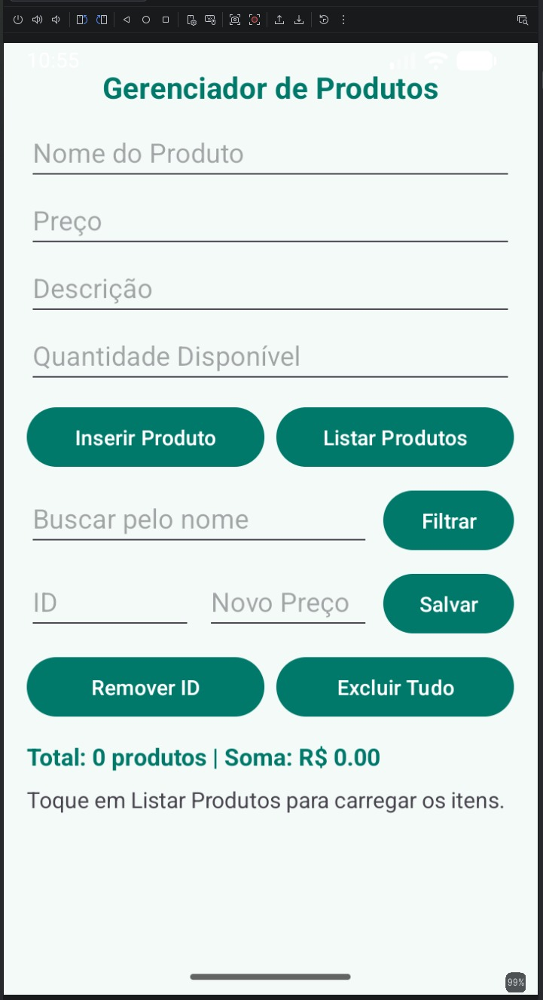
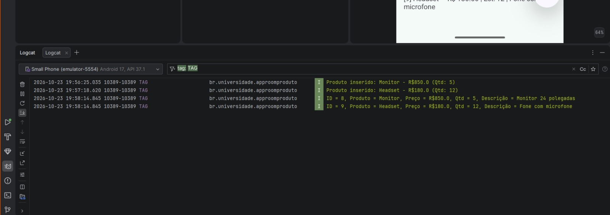
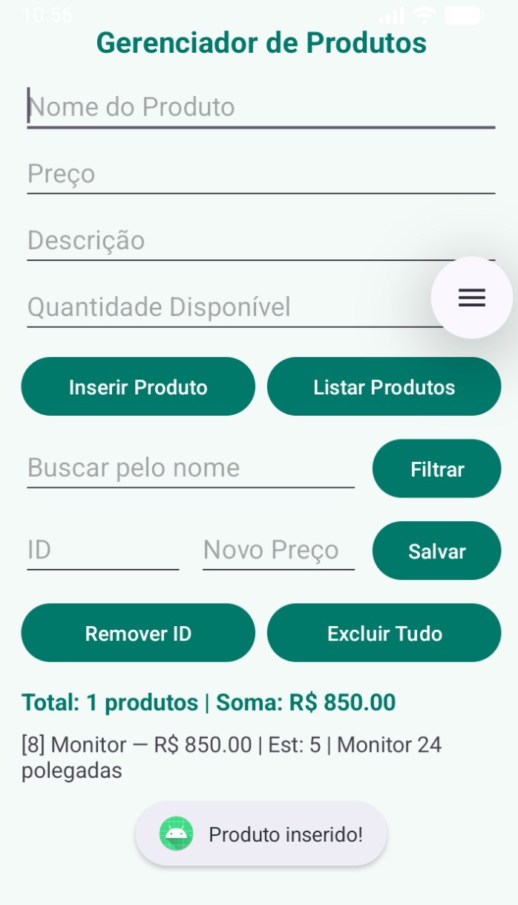
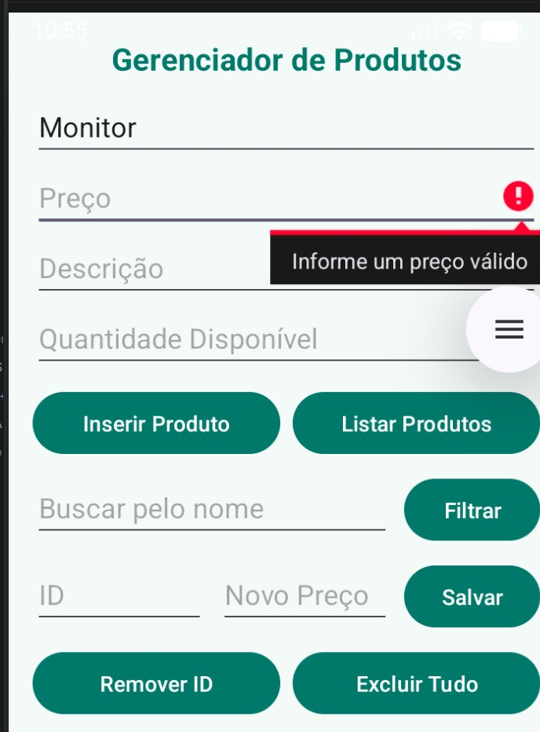
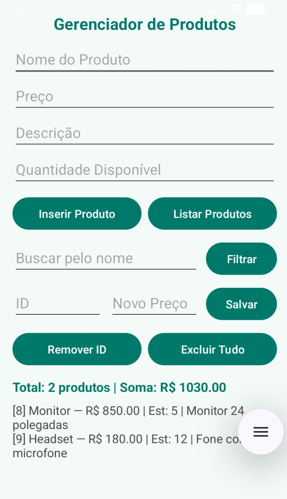
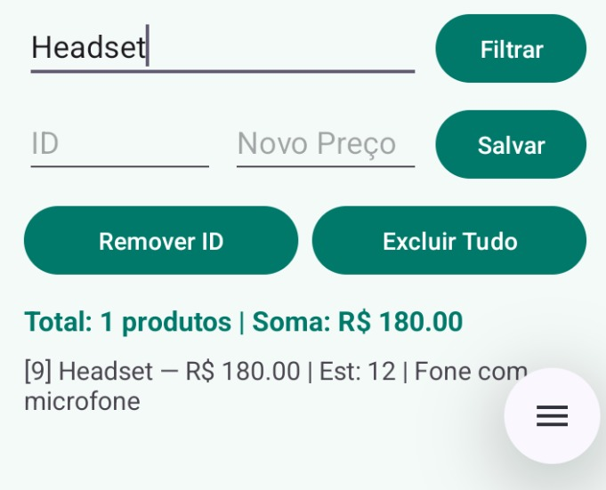
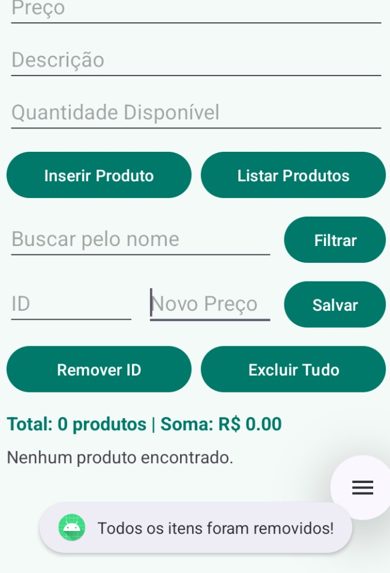
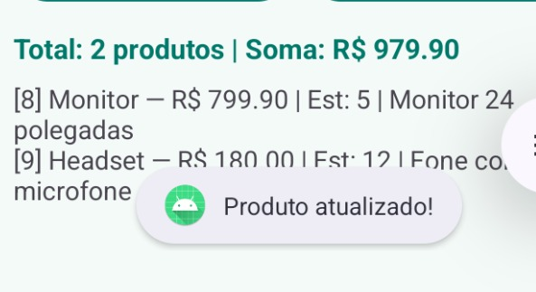
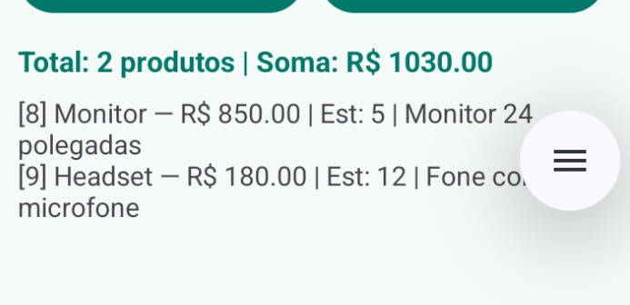

# AppRoomProduto: Cadastro de Produtos com Room SQLite

**Aluno(a):** Isabelle Cabral Siqueira
**RA:** 242265 
**Disciplina:** Programação para Dispositivos Móveis  
**Professor(a):** ALESSANDRO FERREIRA PAZ DE LIMA

## Sobre o projeto
Aplicativo Android desenvolvido em Kotlin utilizando a biblioteca Room (SQLite) para cadastrar, listar, buscar por nome, editar preços e excluir produtos armazenados localmente no dispositivo.

## Tecnologias
- Kotlin
- Room (SQLite)
- ViewBinding
- Corrotinas (`lifecycleScope`)

## Prints do app



## Parte A: Complemento prático

### A1. Limpar campos após inserir
**O que foi feito:** Dentro do bloco `lifecycleScope.launch` do botão `btnInserirProduto`, após salvar o produto no banco de dados, foi utilizado o método `.text.clear()` nos quatro `EditText` da tela e `binding.editProductName.requestFocus()` para devolver o cursor ao primeiro campo.

**Trecho de código (`MainActivity.kt`):**
```kotlin
binding.editProductName.text.clear()
binding.editProductPrice.text.clear()
binding.editProductDescription.text.clear()
binding.editProductQuantity.text.clear()
binding.editProductName.requestFocus()
```
Print: 

### A2. Validação de preço
**O que foi feito:** Foi adicionada a conversão do preço digitado usando `toDoubleOrNull()`. Quando o usuário deixa o campo inválido, igual a zero ou negativo (`price == null || price <= 0.0`), o aplicativo exibe a mensagem `"Informe um preço válido"` através de `binding.editProductPrice.error` e impede a inserção no banco.

**Trecho de código (`MainActivity.kt`):**
```kotlin
val price = priceStr.toDoubleOrNull()
if (price == null || price <= 0.0) {
    binding.editProductPrice.error = "Informe um preço válido"
    return@setOnClickListener
}
```
Print: 

### A3. Lista na tela
**O que foi feito:** Foi adicionado o `TextView` `txtProdutos` no arquivo `activity_main.xml` dentro de um `ScrollView`. Na `MainActivity`, a função `mostrarNaTela()` formata os itens vindos do banco de dados usando `joinToString("\n")` e atualiza o texto diretamente na interface, exibindo `"Nenhum produto encontrado."` caso a lista esteja vazia.

**Trecho de código (`MainActivity.kt`):**
```kotlin
if (products.isEmpty()) {
    binding.txtProdutos.text = "Nenhum produto encontrado."
} else {
    binding.txtProdutos.text = products.joinToString("\n") {
        "[${it.id}] ${it.name} — R$ ${String.format(Locale.getDefault(), "%.2f", it.price)} | Est: ${it.quantity} | ${it.description}"
    }
}
```
Print: 

### A4. Total do estoque
**O que foi feito:** Foi incluído o `TextView` `txtResumo` logo acima da listagem para exibir a contagem de produtos cadastrados (`products.size`) e a soma total dos valores (`products.sumOf { it.price }`) formatada com duas casas decimais.

**Trecho de código (`MainActivity.kt`):**
```kotlin
val qtdRegistros = products.size
val totalPreco = products.sumOf { it.price }
binding.txtResumo.text = String.format(
    Locale.getDefault(),
    "Total: %d produtos | Soma: R$ %.2f",
    qtdRegistros,
    totalPreco
)
```
Print: 

### A5. Buscar por nome
**O que foi feito:** Na interface `ProductDao`, foi criado o método `filtrarPorNome` com a anotação `@Query("SELECT * FROM product WHERE name LIKE :termo")`. Na tela, o campo `edtPesquisa` e o botão `btnPesquisar` consultam o banco passando `"%$busca%"` e mostram na lista apenas os produtos encontrados.

**Trecho de código (`ProductDao.kt` e `MainActivity.kt`):**
```kotlin
@Query("SELECT * FROM product WHERE name LIKE :termo")
suspend fun filtrarPorNome(termo: String): List<Product>

binding.btnPesquisar.setOnClickListener {
    val busca = binding.edtPesquisa.text.toString().trim()
    lifecycleScope.launch {
        val resultado = productDao.filtrarPorNome("%$busca%")
        mostrarNaTela(resultado)
    }
}
```
Print: 

### A6. Excluir produtos
**O que foi feito:** Foram adicionados no `ProductDao` os métodos `apagarTodos()` com `@Query("DELETE FROM product")` para remover todos os produtos de uma vez e `remover(product: Product)` com `@Delete` para excluir apenas o item correspondente ao ID digitado no campo `edtCodigoId`.

**Trecho de código (`ProductDao.kt` e `MainActivity.kt`):**
```kotlin
@Query("DELETE FROM product")
suspend fun apagarTodos()

@Delete
suspend fun remover(product: Product)

binding.btnApagarTudo.setOnClickListener {
    lifecycleScope.launch {
        productDao.apagarTodos()
        mostrarNaTela(emptyList())
    }
}
```
Print: 

### A7. Atualizar produto
**O que foi feito:** Foi criado o método `atualizar(product: Product)` anotado com `@Update` no `ProductDao`. Ao preencher os campos `edtCodigoId` e `edtValorNovo` e tocar em **Salvar**, o app busca o registro pelo ID usando `obterPorId(codigo)`, cria uma cópia com o novo preço (`.copy(price = valorNovo)`) e salva a alteração no banco.

**Trecho de código (`ProductDao.kt` e `MainActivity.kt`):**
```kotlin
@Update
suspend fun atualizar(product: Product)

val produtoAtual = productDao.obterPorId(codigo)
if (produtoAtual != null) {
    val modificado = produtoAtual.copy(price = valorNovo)
    productDao.atualizar(modificado)
    mostrarNaTela(productDao.getAll())
}
```
Print: 

### A8. Novo campo na tabela
**O que foi feito:** Foi adicionado o campo `@ColumnInfo(name = "quantity") val quantity: Int = 0` na classe `Product` e o campo de texto `editProductQuantity` no layout. Em seguida, na classe `AppDatabase`, o número da versão foi alterado de `version = 1` para `version = 2`. Como o banco utiliza `.fallbackToDestructiveMigration()`, ao rodar o aplicativo na versão 2 o Room apagou a tabela anterior (fazendo com que os produtos antigos cadastrados na versão 1 fossem perdidos) e criou uma nova tabela contendo a coluna `quantity`.

**Trecho de código (`Product.kt` e `AppDatabase.kt`):**
```kotlin
@Entity
data class Product(
    @PrimaryKey(autoGenerate = true) val id: Int = 0,
    @ColumnInfo(name = "name") val name: String,
    @ColumnInfo(name = "price") val price: Double,
    @ColumnInfo(name = "description") val description: String?,
    @ColumnInfo(name = "quantity") val quantity: Int = 0
)

@Database(entities = [Product::class], version = 2, exportSchema = false)
abstract class AppDatabase : RoomDatabase() {
    abstract fun productDao(): ProductDao
}
```
Print: 

## Parte B: Questões dissertativas

### B1. O que é persistência de dados? O que aconteceria com os produtos cadastrados se, em vez do Room, eles fossem guardados apenas em uma MutableList dentro da MainActivity?
**Resposta:**
Persistência de dados consiste em gravar as informações do aplicativo no armazenamento interno do dispositivo móvel (como em um banco de dados SQLite gerenciado pelo Room), permitindo que os dados permaneçam salvos mesmo quando o aplicativo é fechado ou o celular é desligado. No nosso projeto `AppRoomProduto`, cada produto cadastrado com `productDao.insertAll(product)` fica guardado no arquivo `"database-name"`, podendo ser consultado novamente a qualquer momento. Caso os produtos fossem armazenados apenas em uma `MutableList<Product>` dentro da `MainActivity`, eles ficariam alocados somente na memória RAM volátil durante a execução daquela tela. Isso significa que, ao fechar o aplicativo, girar a tela sem salvar o estado ou reiniciar o smartphone, toda a lista seria apagada da memória. Dessa forma, o usuário perderia todos os produtos cadastrados sempre que saísse do app.

### B2. Qual é a diferença entre usar o SQLite diretamente (com SQLiteOpenHelper e comandos SQL manuais) e usar o Room? Cite pelo menos duas vantagens do Room.
**Resposta:**
Ao utilizar o SQLite diretamente por meio do `SQLiteOpenHelper`, o desenvolvedor precisa escrever comandos SQL de criação de tabelas manualmente em texto puro, além de usar `ContentValues` para inserir dados e percorrer objetos `Cursor` manualmente para ler cada coluna do banco, o que deixa o código extenso e difícil de dar manutenção. O Room, por sua vez, é uma biblioteca de persistência do Android Jetpack que cria uma camada de abstração sobre o SQLite, transformando classes Kotlin diretamente em tabelas e métodos de interface em consultas SQL. Uma das principais vantagens do Room é a verificação de comandos SQL em tempo de compilação: se houver um erro no nome da tabela ou coluna dentro de `@Query`, o compilador avisa na hora e impede que o aplicativo quebre em tempo de execução. Outra vantagem importante é a facilidade de trabalhar com funções suspensas (`suspend fun`) e corrotinas, convertendo automaticamente os resultados das consultas em listas de objetos `Product`.

### B3. Explique o papel de cada uma das três peças do Room: Entity, DAO e Database. Como elas se relacionam no seu projeto?
**Resposta:**
A **Entity** (Entidade) define o formato da tabela no banco de dados; em nosso aplicativo ela é representada pela classe `Product` anotada com `@Entity`, na qual cada propriedade (`id`, `name`, `price`, `description` e `quantity`) equivale a uma coluna da tabela `product`. O **DAO** (Data Access Object) funciona como um contrato de comunicação com o banco; no projeto ele é a interface `ProductDao` anotada com `@Dao`, onde estão declaradas as operações de banco como `insertAll()`, `getAll()`, `filtrarPorNome()`, `atualizar()` e `apagarTodos()`. Já o **Database** é a classe abstrata `AppDatabase` anotada com `@Database`, que reúne as entidades do banco, define a versão do esquema e disponibiliza o acesso aos DAOs. No fluxo do projeto, essas três partes trabalham juntas: a `MainActivity` cria a instância da `AppDatabase`, obtém o `ProductDao` através do método `productDao()` e utiliza suas funções para gravar, alterar e listar objetos da entidade `Product`.

### B4. Por que o Android não permite acessar o banco de dados na thread principal (UI thread)? O que é um ANR (Application Not Responding)? Como suspend e lifecycleScope.launch resolvem esse problema?
**Resposta:**
O sistema Android bloqueia operações de banco de dados na thread principal (UI thread) porque essa thread é responsável por desenhar os elementos visuais na tela e processar imediatamente os cliques e gestos do usuário. Como a leitura e a escrita em um arquivo SQLite acontecem na memória física do aparelho, essas consultas podem levar mais tempo do que alguns milissegundos, interrompendo a atualização da interface gráfica. Se a thread principal ficar travada aguardando uma consulta demorada por mais de 5 segundos, o Android exibe a mensagem de erro **ANR (Application Not Responding)**, informando que o aplicativo parou de responder. No nosso projeto, o uso de `suspend` nos métodos do `ProductDao` garante que o Room execute o SQL fora da thread principal, enquanto o `lifecycleScope.launch` na `MainActivity` cria uma corrotina que roda a operação de forma assíncrona e só atualiza o `TextView` quando o resultado fica pronto.

### B5. O que faz o fallbackToDestructiveMigration()? Por que ele é perigoso em um app publicado na Play Store? O que seria uma migração (Migration) de banco de dados?
**Resposta:**
O método `.fallbackToDestructiveMigration()` indica ao Room que, sempre que o número de versão em `@Database` mudar e não houver uma regra de migração cadastrada, ele deve apagar todo o banco de dados antigo e recriar as tabelas vazias seguindo a nova estrutura da classe `@Entity`. Durante os testes em aula (como ocorreu no item A8 quando adicionamos o atributo `quantity` e mudamos para `version = 2`), esse recurso facilita o desenvolvimento porque evita que o app feche com erro de esquema incompatível. Entretanto, em um aplicativo publicado na Play Store, deixar o `fallbackToDestructiveMigration()` ativo é muito perigoso, pois ao atualizar o aplicativo o usuário perderia todos os dados que já havia cadastrado anteriormente. Para preservar os dados reais dos usuários em produção, utiliza-se uma **Migration**, que é uma classe responsável por executar comandos SQL de atualização (como `ALTER TABLE`) para adaptar a tabela antiga para a nova versão sem apagar nenhum registro.

### B6. Qual é a vantagem do ViewBinding em relação ao findViewById? Que tipo de erro ele ajuda a evitar?
**Resposta:**
O ViewBinding cria automaticamente uma classe de vinculação (`ActivityMainBinding`) correspondente ao layout XML da tela, permitindo acessar todos os campos e botões diretamente pela variável `binding` sem precisar chamar `findViewById` várias vezes no `onCreate`. Dessa maneira, o código da `MainActivity` fica muito mais enxuto e organizado ao interagir com elementos como `binding.editProductName`, `binding.btnInserirProduto` e `binding.txtProdutos`. Além da praticidade, o ViewBinding evita erros de **Null Safety** (`NullPointerException`), já que não corre o risco de referenciar um ID que pertence a outro arquivo de layout por engano. Ele também garante **Type Safety** (segurança de tipos), eliminando erros de `ClassCastException` que ocorriam quando o programador associava um ID de `TextView` a uma variável do tipo `Button` ou `EditText` usando `findViewById`.

### B7. No tutorial, o banco é criado dentro da MainActivity. Por que em apps maiores é recomendado criar o banco como Singleton (uma única instância para o app inteiro)? O que poderia acontecer se várias telas criassem cada uma o seu banco?
**Resposta:**
A criação de uma instância do banco de dados com `Room.databaseBuilder` é uma tarefa pesada que consome memória RAM e abre conexões diretas com o arquivo SQLite armazenado no aparelho. Em um exercício simples de uma única tela, instanciar o banco dentro da `MainActivity` atende ao objetivo da aula, mas em aplicativos completos com várias telas e `ViewModels` essa abordagem traz problemas de desempenho. Se várias Activities criassem cada uma a sua própria instância do banco ao mesmo tempo, o aplicativo gastaria recursos desnecessários e poderia sofrer conflitos de escrita simultânea (*database lock*) ou leitura de dados desatualizados entre uma tela e outra. Por isso, a boa prática recomendada é utilizar o padrão **Singleton**, mantendo uma única instância compartilhada do `AppDatabase` ativa durante todo o ciclo de vida do aplicativo.

### B8. Reflexão pessoal: quais foram as principais dificuldades que você teve neste projeto e como as resolveu? Cite um app real (de comércio, estoque, saúde, escola etc.) em que a persistência local com Room seria útil e explique como você o aplicaria.
**Resposta:**
Durante a realização desta atividade prática, minha principal dificuldade foi entender como estruturar as consultas personalizadas no `ProductDao` (especialmente o uso do operador `LIKE` com `%` na busca por nome e o `@Update` para alterar o preço pelo ID) e sincronizar a atualização do `TextView` na tela após cada clique. Consegui resolver criando a função `mostrarNaTela()` na `MainActivity` e chamando-a sempre dentro do `lifecycleScope.launch` após cada operação do DAO, garantindo que o resumo de estoque e a listagem ficassem sempre atualizados. Um exemplo real onde o Room seria muito útil é um aplicativo de **cantina ou papelaria escolar**, em que o atendente precisa consultar rapidamente o preço e a quantidade disponível de lanches ou materiais escolares mesmo sem internet, usando uma entidade `Produto` e um DAO para registrar vendas, atualizar quantidades e filtrar itens pelo nome.

## Como executar
1. Clone o repositório
2. Abra no Android Studio
3. Execute em um emulador (API 24+)
